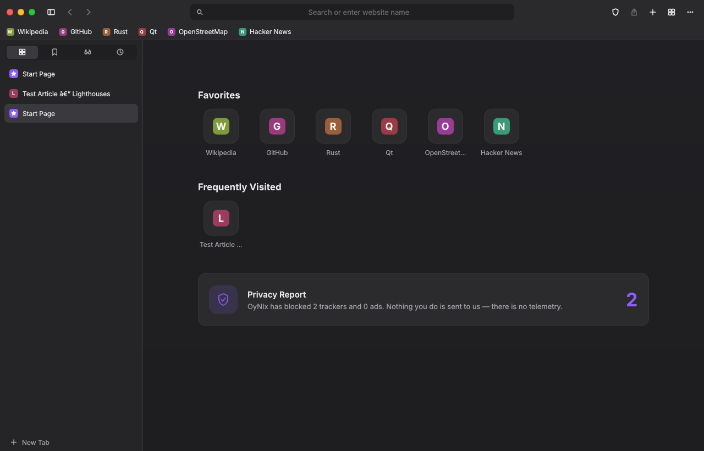
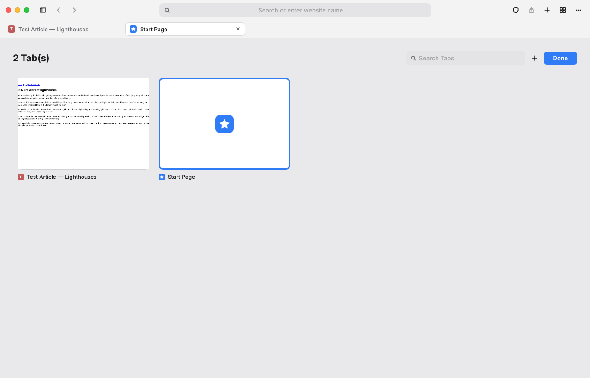
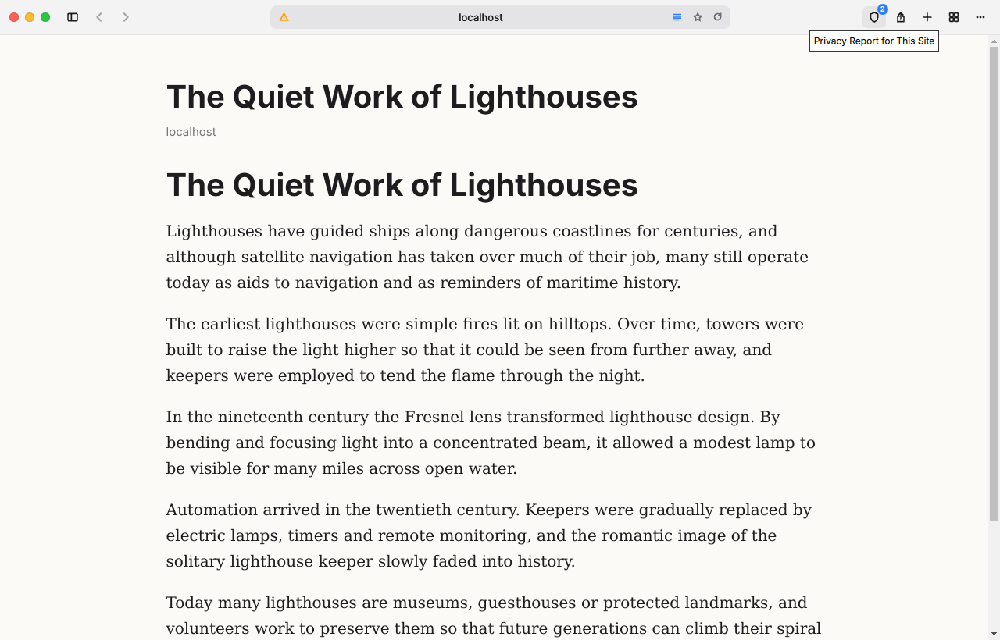

# OyNIx

A fast, private desktop web browser written in **Rust** and **QML**. The interface is drawn by Qt Quick on **Vulkan 1.3 / 1.2**, with **OpenGL ES** as the fallback.

OyNIx's interaction design follows modern macOS-style browsers: quiet chrome, a centred address field showing just the domain, a tab overview, vertical tabs and a focus mode. It ships with tracker and ad blocking switched on and sends no telemetry.



| Tab overview | Reader View |
|---|---|
|  |  |

## Features

| Area | What you get |
|------|--------------|
| **Tabs** | Three layouts: *Standard* (tab bar under the toolbar), *Compact* (tabs inside the toolbar), *Vertical* (sidebar). Pinned tabs, drag to reorder, mute, duplicate, move to a new window. Reopen closed tabs. |
| **Tab overview** | `Ctrl+Shift+\`: a searchable grid of live tab previews. |
| **Memory** | Inactive tabs are unloaded after a configurable time. Restored sessions load lazily, so only the visible tab loads. Low Power Mode freezes background tabs and turns off animations. |
| **Privacy** | Native content blocker (built-in tracker and ad rules plus your own EasyList, uBlock or hosts lists), per-site report, tracking-parameter stripping, third-party cookie blocking, fingerprinting protection, Global Privacy Control, optional Do Not Track. Privacy Report on the Start Page. |
| **Address field** | Shows the domain when idle. Suggestions from bookmarks, history and your search engine, plus 25 built-in `!bang` shortcuts (`!w`, `!gh`, `!yt`, `!mdn`…). |
| **Reading** | Reader View (`Ctrl+Shift+R`), Reading List, Focus Mode (`Ctrl+Shift+F`, hover the top edge to reveal the toolbar). |
| **Library** | Sidebar with Bookmarks, Reading List and History. Favorites bar. HTML bookmark import and export. |
| **Start Page** | Native and instant: Favorites, Frequently Visited, Privacy Report, Reading List. |
| **Website settings** | Per-site zoom, JavaScript, content blocker, pop-ups and reader default. |
| **Profiles** | Fully isolated profiles (`--profile work`), each running as its own app. Private windows. |
| **Extensions** | Chrome and Firefox WebExtensions (`.crx`, `.xpi`, `.zip` or unpacked folder; Manifest V2 and V3) plus lightweight **OyNIx extensions** (`oynix.json` + `content.js` + `content.css`). Toolbar buttons with popups and badges, options pages, per-extension enable/disable. |
| **Power users** | Developer Tools, user scripts (`*.user.js` with Greasemonkey metadata) and user styles (`*.user.css`), custom user agent, Print to PDF, view source. |
| **Windows** | Frameless window with built-in close/minimise/zoom controls (left or right), or the system title bar. Light, dark or auto theme with eight accent colours. |

## Architecture

```
src/
  main.rs            CLI, GPU selection, Qt/WebEngine start-up
  gpu.rs             Vulkan 1.2/1.3 device probe (ash) → Vulkan | GLES | GL | software
  core/              Pure Rust, no Qt types
    omnibox.rs         input → URL, search engines, !bangs, tracking-param stripping
    blocker.rs         network content blocker + statistics
    library.rs         history, bookmarks, reading list, closed tabs
    settings.rs        persistent preferences + per-site overrides
    scripts.rs         injected JS: reader view, GPC, anti-fingerprinting
    paths.rs           XDG paths per profile
  bridge/
    core.rs            CXX-Qt QML singleton `Core` (properties + invokables)
    native.rs          cxx bridge to cpp/native.cpp
cpp/native.cpp       graphics API, WebEngine init, request interceptor, cookie filter
qml/                 the complete UI (BrowserWindow, AddressField, TabStrip, Sidebar,
                     TabOverview, StartPage, SettingsWindow, popovers, Icon set…)
```

Every network request passes through a C++ `QWebEngineUrlRequestInterceptor`, which calls the Rust blocker synchronously. Matching is a few hash lookups per request.

### Graphics backends

| Flag | Backend |
|------|---------|
| *(default)* | Vulkan if a non-CPU device with Vulkan ≥ 1.2 exists. Otherwise OpenGL ES (Wayland/EGL), otherwise desktop OpenGL. |
| `--gpu vulkan` | Qt Quick RHI on Vulkan (1.3 preferred, 1.2 minimum) |
| `--gpu gles` | OpenGL ES 3 via EGL |
| `--gpu opengl` | Desktop OpenGL |
| `--gpu software` | CPU rasteriser |

You can also set `OYNIX_GPU=vulkan`. `oynix --gpu-info` prints the detected Vulkan device. The active backend is shown under Settings › About.

> **Why no GLFW?** Qt Quick creates and owns its window and graphics context through its RHI layer. GLFW would have to replace that, which breaks QML input, popups and Qt WebEngine's compositor integration. The RHI already gives direct Vulkan and GLES rendering, so GLFW isn't needed.

## Building

OyNIx needs **Qt 6.10 or newer** (6.11 recommended) for Qt WebEngine's extension manager. Most distributions don't ship that yet, so a script downloads Qt 6.11 into `./.qt`, and `build.rs` finds it automatically:

```bash
./scripts/deps-ubuntu.sh        # system libraries + rustup + Qt 6.11 into ./.qt
cargo build --release
./target/release/oynix
```

To use a different Qt (for example a distribution's Qt 6.10+), point `QMAKE` at it: `QMAKE=/usr/bin/qmake6 cargo build --release`. If the Qt it finds is older than 6.10, the build stops and tells you how to fix it.

Install for the current user, or build packages. All of them bundle the Qt runtime under `lib/oynix/qt`, so they don't depend on (or conflict with) the system Qt:

```bash
./scripts/install.sh                 # → ~/.local/bin/oynix + desktop entry + icons
./scripts/build-deb.sh [version]     # → target/deb/oynix_<version>_amd64.deb          (Debian/Ubuntu/Mint)
./scripts/build-pkg.sh [version]     # → target/pkg/oynix-<version>-1-x86_64.pkg.tar.zst (Arch/Manjaro)
```

`build-pkg.sh` works on any distribution (it needs only `bsdtar` and `zstd`). On Arch you can also build from source with makepkg: `cd packaging/arch && makepkg -si`.

Install the packages with `sudo apt install ./oynix_*.deb` or `sudo pacman -U oynix-*.pkg.tar.zst`.

### Releases

A version you supply is baked into the binary (`oynix --version`, Settings › About) and the package metadata. Leave it out and the version from `Cargo.toml` is used.

**From GitHub:** open *Actions › Build › Run workflow*, enter a version such as `5.1.0` (optionally tick *pre-release* or *draft*), and run it. The workflow tests the code, builds the .deb and the pacman package, then publishes the release `v5.1.0` with both files and a `SHA256SUMS`. Pushing a tag such as `v5.1.0` does the same. Runs without a version only build the packages and attach them as workflow artifacts.

**From your machine** (needs the GitHub CLI, `gh auth login`):

```bash
./scripts/release.sh 5.1.0             # build both packages and publish v5.1.0
./scripts/release.sh 5.2.0-beta.1      # versions containing '-' are published as pre-releases
./scripts/release.sh 5.1.0 --draft     # create a draft release
./scripts/release.sh 5.1.0 --dry-run   # build only and show what would be published
```

Run the unit tests (omnibox, blocker, library, settings, extensions) with `cargo test`.

## Extensions

Install from **Settings › Extensions** (*From File…* / *From Folder…*), or from the command line:

```bash
oynix --install-extension ublock.crx --install-extension darkreader.xpi --install-extension ./my-ext
oynix --list-extensions
```

| Kind | Accepted | What OyNIx does |
|------|----------|-----------------|
| **Chrome** | `.crx` (v2/v3), `.zip`, folder; MV2 and MV3 | Loads it through Qt WebEngine's extension manager. |
| **Firefox** | `.xpi`, `.zip`, folder; MV2 and MV3 | Rewrites the manifest for Chromium: removes Gecko-only keys, moves MV3 host permissions, turns `background.scripts` into a service worker, maps `menus` to `contextMenus`. `browser.*` works with promises. |
| **OyNIx** | folder or `.zip` with `oynix.json`, `content.js`, `content.css` (all required) | Injects the CSS and JS on pages matching `matches`, at `run_at`, in an isolated (default) or the main world. **New Extension** in Settings creates a ready-to-edit template. |

`manifest_version` must be 2 or 3. Higher numbers don't exist yet; they're accepted and loaded as MV3 with a warning.

Qt WebEngine 6.11 loads extensions and serves their pages, but doesn't run content scripts or provide `chrome.*` APIs. OyNIx supplies those itself:

- **Content scripts** are injected by OyNIx, with match patterns, `run_at`, `all_frames` and CSS.
- **Background** scripts and service workers run in a hidden extension page.
- A **WebChannel-backed runtime** implements:
  - `runtime`: id, getURL, getManifest, sendMessage, onMessage, onInstalled, onStartup, openOptionsPage, lastError
  - `storage`: local, sync, session, onChanged (persisted per profile)
  - `i18n`
  - `tabs`: query, get, create, update, remove, reload, duplicate, sendMessage and the created/updated/activated/removed events
  - `windows.getCurrent` and `windows.getAll`
  - `action` / `browserAction`: badge and title, onClicked
  - `alarms` and `permissions`

**Not supported:** `webRequest` blocking, `declarativeNetRequest`, `scripting.executeScript`, `tabs.executeScript`, long-lived `runtime.connect` ports, devtools panels, native messaging and Firefox `sidebar_action`. Calling these throws or does nothing. Extensions built mainly on them, such as network-filtering ad blockers, won't work fully; OyNIx's built-in blocker covers that need. Extensions don't run in private windows.

## Usage

```
oynix [URL]
oynix --private                 private window
oynix --profile work            separate profile
oynix --gpu vulkan|gles|opengl|software
oynix --wayland | --x11
```

### Keyboard shortcuts

| Action | Keys |
|--------|------|
| New tab / window / private window | `Ctrl+T` / `Ctrl+N` / `Ctrl+Shift+N` |
| Close tab / reopen closed tab | `Ctrl+W` / `Ctrl+Shift+T` |
| Address field | `Ctrl+L`, `Ctrl+K`, `F6` |
| Show all tabs | `Ctrl+Shift+\` |
| Sidebar / Bookmarks / History | `Ctrl+Shift+L` / `Ctrl+B` / `Ctrl+H` |
| Reader View / Focus Mode | `Ctrl+Shift+R` / `Ctrl+Shift+F` |
| Find / next / previous | `Ctrl+F` / `Ctrl+G` / `Ctrl+Shift+G` |
| Bookmark / add to Reading List | `Ctrl+D` / `Ctrl+Shift+D` |
| Zoom in / out / reset | `Ctrl+=` / `Ctrl+-` / `Ctrl+0` |
| Switch tab | `Ctrl+Tab`, `Ctrl+Shift+Tab`, `Ctrl+1…9` |
| Downloads / Settings | `Ctrl+J` / `Ctrl+,` |
| Developer Tools | `F12` (enable under Settings › Advanced) |

## Files

| Path | Contents |
|------|----------|
| `~/.config/oynix/<profile>/settings.json` | preferences and per-site settings |
| `~/.config/oynix/<profile>/filters/*.txt` | extra blocklists (Adblock Plus / uBlock / hosts syntax) |
| `~/.config/oynix/<profile>/userscripts/` | `*.user.js`, `*.user.css` |
| `~/.local/share/oynix/<profile>/` | history, bookmarks, reading list, session, cookies |
| `~/.local/share/oynix/<profile>/extensions/` | installed extensions (+ `extensions.json` registry, `extension-storage/`) |
| `~/.cache/oynix/<profile>/` | HTTP cache |

## License

MIT. See [LICENSE](LICENSE).
